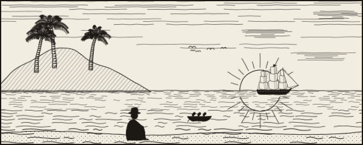
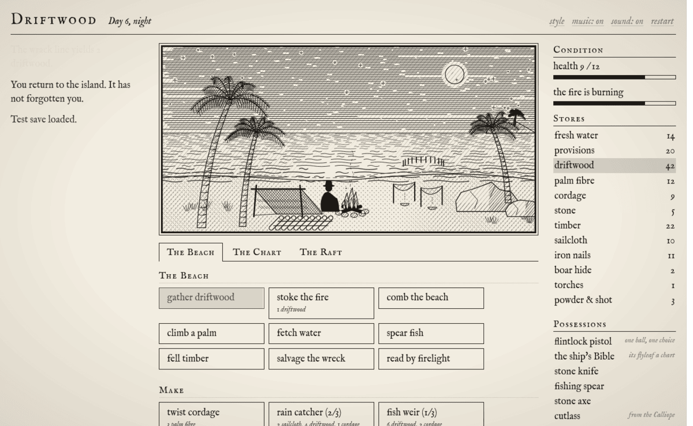
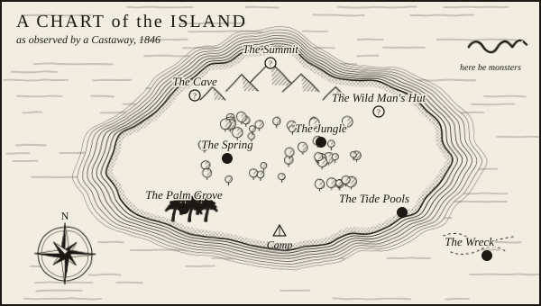
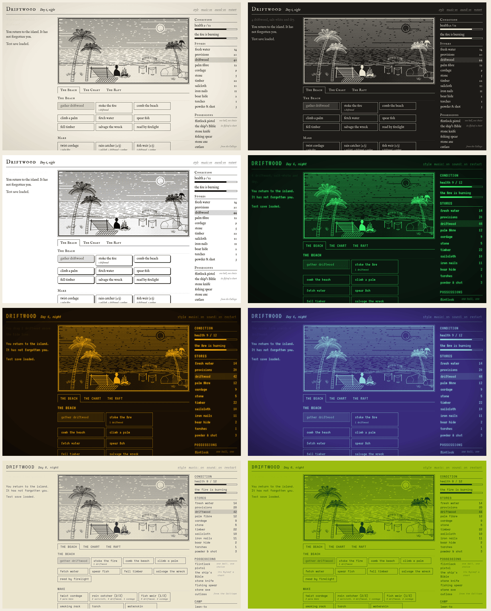

<p align="center">
  
</p>

<h1 align="center">Driftwood</h1>

<p align="center">
  <em>A castaway's tale of the South Seas, 1846.</em><br>
  A slow, text-driven survival game in the spirit of <em>A Dark Room</em>.
</p>

<p align="center">
  <strong><a href="https://benorrin.github.io/Driftwood/">Play it in your browser</a></strong>
</p>

<p align="center">
  <a href="#playing">Run locally</a> ·
  <a href="#the-story">Story</a> ·
  <a href="#features">Features</a> ·
  <a href="#visual-styles">Visual styles</a> ·
  <a href="#how-its-made">How it's made</a>
</p>

---

## The story

> *They rowed you ashore at first light, as the old custom demands: a flintlock with a single ball, a flask of water, a tin of ship's biscuit — and the Bible, so that you might make your peace.*

You were bosun's mate aboard the barque *Meridian*, out of Bristol and bound for Valparaíso. When the crew mutinied you would choose neither side, so the mutineers left you alone on an uncharted island.

Gather driftwood. Keep the fire alive. Explore the island and learn what happened to the brig *Calliope*, wrecked on the same reef twenty years before you. Then find a way home.

<p align="center">
  
</p>

## Playing

Play online at **[benorrin.github.io/Driftwood](https://benorrin.github.io/Driftwood/)**, or run it locally: open **`index.html`** in a browser. That's all you need: there's no build step and no server, and it runs straight from `file://`.

```bash
git clone git@github.com:benorrin/Driftwood.git
cd Driftwood
xdg-open index.html        # macOS: open index.html
```

- Sound starts on your first click, because browsers block autoplay. Music and effects have separate toggles.
- Progress saves automatically to your browser's `localStorage`.
- To host it yourself, publish the folder as-is on any static host (GitHub Pages, Netlify, …).
- The layout adapts to phones.

## Features

|   |   |
|---|---|
| **Survival** | A day/night cycle, a fire to feed, and hunger and thirst every dawn. Nights without a fire are cold, and something prowls beyond the light. |
| **Crafting** | Twist palm fibre into cord. Build a lean-to, stone tools, rain catchers, fish traps and a smoking rack. |
| **Exploration** | A makeshift map drawn on a page torn from your Bible, with fourteen places to find and draw on it: a palm grove, a lagoon, a wreck on the reef, tide pools, a spring, a sealers' camp, bird cliffs, a gum wood, a blowhole, the jungle, an old stone platform, a cave, a hut, and the summit. Each turns up only once the story gives you reason to look; you may find it exploring, follow a clue to it, or spot it from somewhere else. |
| **Combat** | Turn-based fights with land crabs, a wild boar, a viper, a shark… and perhaps a man. Fight with a knife, spear, cutlass, or your one precious pistol ball, and watch for the moment to brace against a heavy blow. |
| **Story** | A message in a bottle, a captain's log and a dead man's journal lead you through the island's history, and you make choices that change the ending. |
| **Happenings** | Sails that pass you by, things the tide brings in, and stranger finds inland. Some are nods to other castaways. |
| **Endings** | Build a raft and brave the open sea, or build a signal pyre and wait for the trade winds to bring a ship past. |

<p align="center">
  
</p>

## Visual styles

Choose **style** in the top bar, or **visual style** on the title screen, to change how the island is drawn. The idea comes from the monitor palettes in *Return of the Obra Dinn*. Every illustration is drawn in just two colours, so swapping the palette repaints the whole game.

<p align="center">
  
</p>

| Style | Look | Extras |
|---|---|---|
| **Engraving** | ink on rag paper | the default |
| **Night Watch** | chalk on slate | |
| **Macintosh** | 1-bit black and white, 1984 | rounded buttons, striped title bars |
| **IBM 5151** | green phosphor | CRT scanlines, glow, terminal font |
| **Zenith ZVM-1240** | amber phosphor | CRT scanlines, glow, terminal font |
| **Commodore 1084** | cyan on violet | CRT scanlines, glow, terminal font |
| **IBM 8503** | grey-white monochrome | monospaced |
| **Pocket LCD** | four shades of pea | pixel grid |

To add your own style, add an entry to the list in [`js/styles.js`](js/styles.js) with an ink colour, a paper colour, a font, and optionally a screen effect (`crt`, `mac` or `lcd`).

## How it's made

The game has **no asset files at all.** Everything you see and hear is generated in the browser.

| Files | What they do |
|---|---|
| [`js/art/`](js/art) | Draws every illustration as SVG in code, in the manner of a 19th-century wood engraving: hatching, stipple and ink line, roughened with an SVG displacement filter so nothing is quite ruler-straight. `draw.js` holds the palette and SVG helpers; `nature.js` and `objects.js` draw the parts; `camp.js`, `chart.js`, `scenes.js` and `foes.js` compose the pictures. |
| [`js/audio/`](js/audio) | Synthesises all the sound with the Web Audio API: breaking surf, a crackling fire (`ambience.js`), an original fiddle lament in D dorian and a heartbeat drum for fights (`music.js`), ship's bells at dawn and every sound effect (`effects.js`), all built on the engine in `synth.js`. |
| [`js/game/`](js/game) | The game itself: state and saving (`state.js`), camp actions and crafting (`camp.js`), the clock (`clock.js`), exploration (`locations.js`, `story.js`), random happenings (`events.js`), combat (`combat.js`), endings (`endings.js`), and drawing the screen (`ui.js`, `render.js`). `main.js` starts it all. |
| [`js/styles.js`](js/styles.js) | The visual style palettes. |
| [`js/core.js`](js/core.js) | The shared `DW` namespace and safe `localStorage` helpers. |
| [`css/`](css) | Layout (`base.css`, `screens.css`, `game.css`, `modal.css`) and the screen effects of the visual styles (`themes.css`). |

The scripts are plain `<script>` tags rather than ES modules, so the game still runs from `file://`. They share one global namespace, `DW`, and [`index.html`](index.html) loads them in dependency order.

The only external dependencies are three fonts from Google Fonts: [IM Fell English](https://fonts.google.com/specimen/IM+Fell+English), plus [VT323](https://fonts.google.com/specimen/VT323) and [Space Mono](https://fonts.google.com/specimen/Space+Mono) for the retro styles. When you're offline the page falls back to Georgia or Courier.

<details>
<summary><strong>Spoiler-light hints</strong></summary>
<br>

- Keep the fire burning at night. Some things on this island are afraid of it.
- Twist palm fibre into rope. Almost everything needs it.
- Read every bottle and journal you find. They tell you where to go next.
- There is more than one way off the island, and more than one way to treat the man in the jungle.

</details>

## License

[GNU General Public License v3.0](LICENSE)
